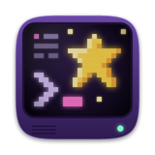
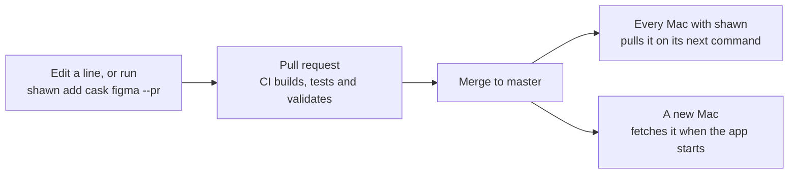

<p align="center">
  
</p>

<h1 align="center">Shawn's Dotfiles</h1>

<p align="center">one Mac, zero lumps</p>

<p align="center">A native Mac app and a command line tool that set up a brand-new Mac from a folder of YAML files. Fork it and change the YAML to set up yours.</p>


Lumpy Space Princess (LSP) from Adventure Time narrates, and each step puts one of eight [fan-made](#fan-art) pixel-art characters on screen. The GIF uses sample data and squeezes a whole run into 19 seconds.

<p align="center">
  <a href="https://github.com/shawntz/dotfiles/actions/workflows/installer.yml"></a>
  
  <a href="LICENSE"></a>
</p>

Watch a dry run on your own Mac running macOS 27 or later. It changes nothing, and it needs Xcode 27 or later to build:

```sh
git clone https://github.com/shawntz/dotfiles.git shawns-dotfiles
cd shawns-dotfiles/installer && make run
```

[What it does](#what-it-does) · [How the config works](#how-the-config-works) · [When it needs you](#when-it-needs-you) · [Try it](#try-it) · [Make it yours](#make-it-yours) · [The shawn command](#the-shawn-command) · [More](#more)

## What it does

Open the app on a new Mac and press START. Apple's Command Line Tools and Homebrew go on first. Xcode is huge, so it downloads in the background while the apps, Homebrew packages and AI tools install. The installer makes an SSH key, signs in to GitHub with a code you approve and turns on commit signing. It writes your shell, editor, terminal and keyboard config and sets macOS preferences. Then it clears the Dock and fills it with six apps and your `~/Developer` folder. The last step waits up to three hours for Xcode, then sets it up. You end on a checklist of the jobs only you can do, such as logging out so the new key repeat takes effect.

The parts worth copying:

- One line per thing. `- brew: ripgrep` is a complete item, and so is `- cask: slack`.
- An app and a command line tool that run the same code. In a terminal, `shawn install` works through the 17 steps from the same YAML.
- A dry run that changes nothing and shows what each item would do, with the commands it would run.
- Safe to run again. Each item checks what is already done first, so a second run only does what is missing. Four cases run every time: `open:`, a `script:` with no `check:` or `creates:`, a `download:` with `replace: true` and a `.pkg` download with no `app:`.
- Backups. Before the installer replaces a file, it moves the old one to `~/.shawn/backups/<run>/`. The old Dock layout goes there too.
- Nobody else's name on your commits. It asks for your name and email for Git instead of shipping Shawn's.
- It keeps itself current. Before most commands, `shawn` checks GitHub, pulls new config and rebuilds itself from the checkout when its Swift sources change. `self_update.mode` in `cli.yaml` can make that `daily` or `off`.

The config in this repo has 176 items in 17 steps. That is 47 Homebrew formulae, 43 casks, 3 App Store apps besides Xcode, 2 web apps and 17 checklist reminders, plus 64 items for jobs such as copying dotfiles, writing macOS settings and setting up git and GitHub. All 176 run by default, and CUSTOMIZE… has a checkbox for each one.

<details>
<summary>The 17 steps</summary>

| Step | Title | What it covers | Items |
|---|---|---|---:|
| 01 | Bootstrap | Command Line Tools, Homebrew and Xcode | 4 |
| 02 | Dropbox | Install it, open it, sign in | 2 |
| 03 | Homebrew Packages | Formulae and casks from the old laptop | 62 |
| 04 | Apps | Casks, App Store apps and a direct download | 33 |
| 05 | AI Tools | Claude Code, Codex, ChatGPT and Grok | 8 |
| 06 | Git & GitHub | Identity, SSH key, GitHub sign-in, signed commits | 8 |
| 07 | Agent Skills | Shared skills for Claude Code, Codex and Grok | 8 |
| 08 | Developer Folder | ~/Developer and the dotfiles checkout | 2 |
| 09 | Shell & Editor | zsh, Starship, Ghostty and Neovim | 6 |
| 10 | Keyboard | Karabiner-Elements and Hammerspoon | 12 |
| 11 | Herdr Terminal | The Herdr app, Herdr core and agent hooks | 7 |
| 12 | Claude Code | Settings, spinner phrases and plugins | 6 |
| 13 | Web Apps | Websites as standalone apps | 2 |
| 14 | The shawn CLI | shawn claude, shawn update and friends | 1 |
| 15 | macOS Settings | Keyboard, Finder, trackpad, menu bar and windows | 7 |
| 16 | Dock | Cleared out, then set up for work | 1 |
| 17 | Finishing Up | Xcode, then the to-do list | 7 |

Each row is one file in [`installer/config/steps`](installer/config/steps). `shawn config show` prints every item in every step.

</details>

## How the config works

> "Copying your old laptop's taste. It had good taste. Like me."\
> LSP in the app, during the packages step

[`installer/config`](installer/config) holds everything the installer does:

```text
installer/config/
  installer.yaml   name, tagline, where newer config comes from, variables, questions
  steps/           one file per step, run in filename order
  files/           the files that copy and json-merge items install
  skills/          agent skills bundled with the installer
  cli.yaml         the shawn command's settings and its YAML commands
  fun/             the banner, LSP's lines and the pixel-art characters
```

A step file is a title and a list of items. This is all of `steps/13-webapps.yaml` apart from its comments:

```yaml
id: webapps
title: Web Apps
subtitle: Websites as standalone apps
mascot: bubblegum

items:
  - webapp: Carbon
    url: https://my.carbonapp.co
  - webapp: X
    url: https://x.com
```

Each `webapp:` item builds `/Applications/<name>.app` around a small browser shell, with its own window, Dock icon and sign-in. `mascot: bubblegum` puts Princess Bubblegum on screen while the step runs.

Every item starts with its kind, and the value is the thing it acts on. Some lines from the shipped config, and what they do:

| In the config | On the Mac |
|---|---|
| `- brew: ripgrep` | `brew install --formula ripgrep`, unless it is installed already |
| `- cask: slack` with `app: Slack.app` | `brew install --cask slack`, unless Slack.app is already in /Applications, however it got there |
| `- mas: 937984704` with `name: Amphetamine` | `sudo mas install 937984704`, once you are signed in to the App Store |
| `- ssh-key: ~/.ssh/id_ed25519` | `ssh-keygen -t ed25519` when the key does not exist yet. It never overwrites a key. |
| `- git-signing: ~/.ssh/id_ed25519.pub` | Sets `gpg.format ssh` and turns on `commit.gpgsign` and `tag.gpgsign`, so Git signs every commit and tag with that key |
| `- copy: zsh/zshrc` with `to: ~/.zshrc` | The old `~/.zshrc` goes to the backups, then the new one takes its place |
| `- defaults: com.apple.finder` with `set:` and `restart: [Finder]` | A `defaults write` for each key that differs, then a Finder restart if anything changed |
| `- manual: Log out and back in` | A line on the checklist at the end |

<details>
<summary>More real excerpts</summary>

From `steps/03-packages.yaml`. A comment can say why a package is there:

```yaml
  - brew: bat              # preview in the zsh `ff` alias
  - brew: fd               # LazyVim file search
  - brew: git-lfs          # the old git config turned on the LFS filter
  - brew: ripgrep          # LazyVim text search
```

From `steps/15-macos.yaml`. Each key under `set:` is one setting. The YAML value picks the type, so `true` goes in as `-bool true` and `2` as `-int 2`:

```yaml
  - defaults: com.apple.AppleMultitouchTrackpad
    name: Trackpad
    set:
      Clicking: true                        # tap to click
      TrackpadRightClick: true              # click with two fingers to right-click
      FirstClickThreshold: 2                # firm click: more pressure than the default
```

From `steps/10-keyboard.yaml`. A `manual:` item puts a reminder on the checklist, and `url:` gives it an Open button. `check:` is a shell command, and once it exits 0 the reminder stays off the list:

```yaml
  - manual: Give Karabiner Accessibility access
    detail: >-
      System Settings → Privacy & Security → Accessibility: turn on
      Karabiner-Core-Service.
    url: x-apple.systempreferences:com.apple.preference.security?Privacy_Accessibility
    check: >-
      "/Library/Application Support/org.pqrs/Karabiner-Elements/bin/karabiner_cli"
      --show-settings-window-guidance 2>/dev/null |
      grep '"accessibility_process_trusted": *true' >/dev/null
```

</details>

<details>
<summary>All 29 item kinds</summary>

| Group | Kinds |
|---|---|
| Packages | `xcode-clt`, `homebrew`, `rosetta`, `xcode`, `tap`, `brew`, `cask`, `mas`, `npm`, `download`, `script` |
| Files and settings | `copy`, `symlink`, `mkdir`, `json-merge`, `defaults`, `dock`, `open`, `manual`, `login-item`, `shawn-cli` |
| Git, GitHub and agents | `git-config`, `ssh-key`, `github`, `git-signing`, `clone`, `skill`, `claude-plugin` |
| Web apps | `webapp` |

`shawn config kinds` prints each kind with a summary and an example. The [manual](installer/README.md#item-kinds) lists every option.

</details>

### It asks who you are

> "Your name, not mine. Putting mine on your commits would be so awkward."\
> LSP in the app, when the installer asks a question

The config ships no name or email. `installer.yaml` asks for them. This is its `ask:` block, trimmed of the lines that offer a default:

```yaml
ask:
  - var: full_name
    prompt: Your name, as Git should record it on your commits
  - var: email
    prompt: Your email address for Git commits
    format: email
```

The git step uses the answers like any other variable:

```yaml
  - git-config:
      user.name: "{{full_name}}"
      user.email: "{{email}}"
      init.defaultBranch: main
```

Return keeps the offered answer, which comes from git on this Mac when it has one. The answers go in `~/.shawn/answers.json`. Later runs reuse them, and `shawn install --ask` asks again.

<details>
<summary>How the questions work</summary>

This is the whole `ask:` block. Each `default_command` runs before its question, and the installer offers its first line of output as the answer:

```yaml
ask:
  - var: full_name
    prompt: Your name, as Git should record it on your commits
    default_command: >-
      tools=$(xcode-select -p 2>/dev/null) && [ -x "$tools/usr/bin/git" ]
      && git config --global --get user.name || id -F
  - var: email
    prompt: Your email address for Git commits
    default_command: >-
      tools=$(xcode-select -p 2>/dev/null) && [ -x "$tools/usr/bin/git" ]
      && git config --global --get user.email
    format: email
```

The installer asks every question the chosen steps need before the first item runs, even before the admin password. It skips any question that already has an answer. `default_command` calls git only when the developer tools are installed, because on a new Mac `git` is Apple's stub and running it opens an install dialog. On a new Mac, `id -F` offers the full name of your macOS account instead. `format: email` turns down a reply that does not look like an address and asks again. `shawn config answers` shows the saved answers. If you skip a question, the items that need its answer wait for the next run instead of failing.

</details>

### How a change reaches every Mac

Most changes are one line. Write it by hand, or let `shawn` write it:

```sh
shawn add cask figma --pr
```

That installs Figma now and adds its line to `steps/04-apps.yaml` next to the other casks. Then it commits that one file on a new branch, pushes it and opens a pull request with `gh`. For edits by hand, `shawn pr -m "Add Figma"` commits everything uncommitted in the config and opens the pull request the same way.



A new command in `cli.yaml` works on the same call that pulls it. A new package or setting waits until you run `shawn sync`, another name for `shawn install`. `shawn` reminds you after the pull that brings it. If your checkout has local changes, `shawn` leaves it alone and prints a note that says why.

## When it needs you


In the order the GIF shows them:

1. CUSTOMIZE… lists every step and item with a checkbox. An item marked `optional: true` starts unchecked. This config has none, so every box starts checked.
2. Your name and email for Git. The installer asks once per Mac and keeps the answers.
3. Your admin password, once per run. Only the commands of these items can use it, and only while they run: the Command Line Tools, Rosetta, Homebrew, casks, App Store apps, Xcode, `.pkg` downloads and items marked `sudo: true`.
4. The App Store. macOS has no way to sign in to it from a script, so the app asks you to sign in yourself or skip App Store apps. Each skipped app lands on the checklist with a link to its store page.
5. GitHub. The app shows a one-time code in large type, copies it to your clipboard and opens github.com/login/device. Paste the code there and approve the sign-in. The app then uploads your new SSH key for pushing and for signing commits.
6. The end of a dry run, which opens on its log. RUN FOR REAL… takes you back to START with DRY RUN off and the same selection.

## Try it

There is no release to download yet, so you build it yourself with Xcode 27 or later. It runs on macOS 27 or later. CI builds and tests it on macOS 27 with Xcode 27.2 and Swift 6.4. The safe first step is a dry run:

```sh
git clone https://github.com/shawntz/dotfiles.git shawns-dotfiles
cd shawns-dotfiles/installer
make run
```

`make run` builds the installer and opens it in demo mode. That is a dry run that treats your Mac as brand new and starts by itself, so you watch all 17 steps and what each item would do. Nothing on your Mac changes.

> "Dry run! I'm just pretending. Like drama class, but nothing breaks."\
> LSP in the app, during a dry run

In a terminal, the dry run checks your Mac and prints what a real run would change:

```sh
swift build
.build/debug/shawn --no-update install --dry-run
```

`--no-update` stops `shawn` from looking on GitHub for a newer version of itself first.

<details>
<summary>What a dry run prints</summary>

These are the six items of `steps/09-shell.yaml`, without its section comments:

```yaml
  - copy: zsh/zprofile          # PATH: Homebrew, ~/.local/bin, ~/.grok/bin
    to: ~/.zprofile
  - copy: zsh/zshrc             # history, completion, prompt, aliases
    to: ~/.zshrc
  - copy: zsh/hushlogin         # empty: hides "Last login: ..." in new terminals
    to: ~/.hushlogin
  - copy: starship/starship.toml
    to: ~/.config/starship.toml
  - copy: ghostty/config
    to: ~/.config/ghostty/config
  - copy: nvim
    to: ~/.config/nvim
    if_missing: true
```

This is that step in a dry run on Shawn's laptop, where two of the six are already done:

```text
== [9/17] Shell & Editor · zsh, Starship, Ghostty and Neovim ==
  → ~/.zprofile
    [dry-run] backing up ~/.zprofile → ~/.shawn/backups/20261115-110212/.zprofile
    [dry-run] update ~/.zprofile
  ✓ ~/.zprofile: would update ~/.zprofile
  → ~/.zshrc
    [dry-run] backing up ~/.zshrc → ~/.shawn/backups/20261115-110212/.zshrc
    [dry-run] update ~/.zshrc
  ✓ ~/.zshrc: would update ~/.zshrc
  · ~/.hushlogin: already done (up to date)
  → ~/.config/starship.toml
    [dry-run] backing up ~/.config/starship.toml → ~/.shawn/backups/20261115-110212/.config/starship.toml
    [dry-run] update ~/.config/starship.toml
  ✓ ~/.config/starship.toml: would update ~/.config/starship.toml
  → ~/.config/ghostty/config
    [dry-run] backing up ~/.config/ghostty/config → ~/.shawn/backups/20261115-110212/.config/ghostty/config
    [dry-run] update ~/.config/ghostty/config
  ✓ ~/.config/ghostty/config: would update ~/.config/ghostty/config
  · ~/.config/nvim: already done (exists, and if_missing leaves it alone)
```

Every file it would replace goes to the backups first. `~/.hushlogin` already matches, and `if_missing: true` leaves an existing Neovim setup alone.

</details>

### For real

A real run makes your Mac match this config. That means the apps, key remaps, shell and macOS settings from Shawn's laptop, and a Dock that keeps only six apps and your `~/Developer` folder. There is no uninstall, so apps and packages stay installed. Replaced files wait in `~/.shawn/backups/<run>/`. The log keeps the old value of each macOS setting the run changes. Fork it and [make it yours](#make-it-yours) before you run it on a Mac you care about. Then build the app from your fork's checkout:

```sh
cd ~/Developer/dotfiles/installer
make app SIGN_IDENTITY=-
open "build/Shawn's Dotfiles.app"
```

`SIGN_IDENTITY=-` signs the app ad hoc. After the first run, `shawn` is in `~/.local/bin` and `shawn install` runs the same installer in a terminal.

To set up another Mac, copy `build/Shawn's Dotfiles.app` to it. Online, the app uses the newest config from the `remote:` repo in `installer.yaml`, so push your changes to your fork first. The copy inside the app is the fallback when GitHub is out of reach.

macOS blocks an ad hoc build that reached another Mac as a download or by AirDrop. Try to open it once, then click Open Anyway in System Settings, under Privacy & Security.

<details>
<summary>If something goes wrong</summary>

- A failed item shows on the final screen with its error. RETRY FAILED runs the same selection again and skips what is already done.
- A real run writes its log to `~/Library/Logs/ShawnsDotfiles/install-<date>-<time>.log`. VIEW LOG shows it, with a COPY button.
- STOP marks the running item as stopped, not failed. RESUME runs the same selection again and skips what is done.
- To put a file back, take it from `~/.shawn/backups/<run>/`. For the Dock, run `defaults import com.apple.dock` with the saved `com.apple.dock.plist`, then `killall Dock`.
- To put a macOS setting back, find its old value in the log, as in `com.apple.WindowManager EnableTiledWindowMargins: unset → false`. Then `defaults write` or `defaults delete` restores it.
- `shawn doctor` checks this Mac against the config and changes nothing.

</details>

## Make it yours

Fork the repository. The steps below change only the config, so you never edit Swift:

1. Clone your fork to `~/Developer/dotfiles`. The developer step clones the repo there, and the installed `shawn` uses it as its checkout.
2. In `installer/config/installer.yaml`, point `remote.repo` at your fork. The app and `shawn` look there for new config and new versions of `shawn`. Set `vars.dotfiles_repo` to your fork too, and `vars.github_user` to your GitHub username.
3. Change `name:` and `tagline:`. The tagline shows under the banner in the app and in `shawn help`. The banner itself is `fun/header.txt`.
4. Go through `steps/` and delete what you do not want. `enabled: false` leaves a whole step unchecked, and `optional: true` does the same for one item. To leave out a step file without deleting it, rename it to start with `_`.
5. If the Mac you use now runs macOS 27 or later and has Xcode 27 or later, run `swift build` in `installer/`, then `.build/debug/shawn drift --repo ~/Developer/dotfiles`. It prints a YAML line for each Homebrew, App Store and npm package you have that the config lacks. Add `--write` and it puts those lines in the step files.
6. Replace the dotfiles in `installer/config/files/` with yours: zsh, Starship, Ghostty, Neovim, Karabiner, Hammerspoon, Herdr, Git's ignore file and Claude Code's settings. Do the same with the agent skills in `installer/config/skills/`.
7. In `installer/`, run `make validate`. It checks the config the way CI does and lists every problem. For a misspelled key such as `ap:` on a cask, it suggests `app:`. Then `make run` shows your config in a dry run.
8. Commit and push to `master` on your fork. A new Mac's app fetches its config from there, and `shawn` pulls it into each Mac's checkout.

<details>
<summary>Local settings, your own art and the names that stay Shawn's</summary>

You can leave your name and email out, because the installer asks for them. Put settings that belong to one Mac in `~/.zshrc.local` and `~/.gitconfig.local`. The installed shell and git config read both, and nothing in the config writes them.

LSP's lines live in `fun/quotes.yaml` and the characters in `fun/sprites/`. To use your own art, put a PNG or JPEG in `fun/images/` and add `image: images/<file>` to a sprite. The app shows your image, and the terminal keeps the pixel art.

Some names stay Shawn's after a fork, because they live in the code: the command `shawn`, the app `Shawn's Dotfiles.app`, the `~/.shawn` and `~/.config/shawn` folders, the `~/Library/Logs/ShawnsDotfiles` log folder and the `com.shawnschwartz` bundle ids. If you publish releases, set `RELEASE_REPO` to your fork. It defaults to `shawntz/dotfiles`, and `installer/scripts/release.sh --help` explains it.

</details>

## The `shawn` command

`shawn` has 34 commands, and 14 of them are YAML in [`cli.yaml`](installer/config/cli.yaml), so a new command is a pull request, not a rebuild.

| Command | What it does |
|---|---|
| `shawn install` | The installer in a terminal, with `--dry-run`, `--only git,shell` and `--skip apps` |
| `shawn doctor` | Checks this Mac against the config and changes nothing |
| `shawn drift` | What is installed but not in the config, with the YAML line to add, and the reverse |
| `shawn add <kind> <name> --pr` | Installs it, writes its line and opens the pull request |
| `shawn upgrade` | Runs the 10 upgrades in `cli.yaml` in order, from `brew upgrade` to `herdr integration install` |
| `shawn claude` | Updates Claude Code, then starts it with the `shawn` status line |
| `shawn ports`, `shawn killport 3000` | What is listening on which port, and a way to stop it |
| `shawn lsp` | Lumpy Space Princess has something to say |

```text
$ shawn lsp


           ▄████▄ ▄▄▄▄
     ▄███▄█████████████▄
    █████████████████████
    ████████████████████▀   ╭─────────────────────────────────────────────╮
    ▀██████████████████▀   ─┤ I cleared my whole schedule for this. Well, │
   ▄████████████████████▄   │ I moved Brad to Thursday.                   │
  ██▀██████████████████▀██  ╰─────────────────────────────────────────────╯
     ██████████████████
      ▀▀▀▀ ▀████▀ ▀▀▀▀

            ▀▀▀▀
```

<details>
<summary>Every command, as <code>shawn help</code> lists them</summary>

```text
  ███████╗██╗  ██╗ █████╗ ██╗    ██╗███╗   ██╗  ██╗███████╗
  ██╔════╝██║  ██║██╔══██╗██║    ██║████╗  ██║ ▄█╔╝██╔════╝
  ███████╗███████║███████║██║ █╗ ██║██╔██╗ ██║ ╚═╝ ███████╗
  ╚════██║██╔══██║██╔══██║██║███╗██║██║╚██╗██║     ╚════██║
  ███████║██║  ██║██║  ██║╚███╔███╔╝██║ ╚████║     ███████║
  ╚══════╝╚═╝  ╚═╝╚═╝  ╚═╝ ╚══╝╚══╝ ╚═╝  ╚═══╝     ╚══════╝

██████╗  ██████╗ ████████╗███████╗██╗██╗     ███████╗███████╗
██╔══██╗██╔═══██╗╚══██╔══╝██╔════╝██║██║     ██╔════╝██╔════╝
██║  ██║██║   ██║   ██║   █████╗  ██║██║     █████╗  ███████╗
██║  ██║██║   ██║   ██║   ██╔══╝  ██║██║     ██╔══╝  ╚════██║
██████╔╝╚██████╔╝   ██║   ██║     ██║███████╗███████╗███████║
╚═════╝  ╚═════╝    ╚═╝   ╚═╝     ╚═╝╚══════╝╚══════╝╚══════╝
  one Mac, zero lumps

  "Welcome to Lumpy Space. It's super exclusive, but you're on the list."  Lumpy Space Princess

AI
  claude        Claude Code with the shawn status line (updates first)
  codex         Codex with a fuller status line and title (updates first)
  grok          Grok CLI in your terminal's own colors (updates first)

Network
  ports         What is listening on which TCP port
  killport      Stop whatever is listening on a port
  ip            Local and public IP addresses

Dev
  keys          Show your SSH public keys and copy one to the clipboard
  clean         Reclaimable space in developer caches (--yes to clean)
  brewfile      Print a Brewfile generated from the config
  serve         Serve the current directory over HTTP on localhost
  path          Your PATH, one entry per line (flags missing and duplicates)
  whatsup       Repos in ~/Developer with uncommitted or unpushed work
  today         Commits you made today, across ~/Developer

Mac
  awake         Keep this Mac awake for a while

Set up this Mac
  install       Set this Mac up from the config (safe to re-run)
  doctor        Read-only health check of this Mac against the config
  drift         What's installed but not in the config (and the reverse)
  upgrade       Upgrade everything (Homebrew, App Store, AI CLIs, skills, …)

Config & sync
  version       Version, where the config comes from, last update check
  add           Install something now and add it to the config
  pr            Open a pull request with your config changes
  update        Pull the latest shawn and config from GitHub right now
  config        Where the config is, what it plans, and whether it is valid

Projects
  projects      Git repos in ~/Developer with branch and state
  clone         Clone a GitHub repo into ~/Developer
  new           Start a new project in ~/Developer (git, README, .gitignore)

Fun
  lsp           Lumpy Space Princess has something to say
  quote         A random line from the show (or a quip)
  party         Everybody on screen at once
  banner        The ASCII header

Shell
  help          This screen, or details for one command
  statusline    Claude Code's status line (reads its JSON on stdin)
  shell-init    Shell integration: completion, sd, cd after clone/new
  completions   Print the zsh completion script

shawn help <command> for details · --no-color for plain output
--no-update (or SHAWN_NO_UPDATE=1) skips shawn's own update and the tool's:
  shawn --no-update claude, or shawn claude --no-update
SHAWN_NO_SELF_UPDATE=1 skips only shawn's own update
```

</details>

<details>
<summary>How to write a YAML command</summary>

This is all of `shawn path` in `cli.yaml`. `run:` is a bash script for macOS's bash 3.2, and your arguments arrive as `"$@"`:

```yaml
  path:
    section: Dev
    summary: Your PATH, one entry per line (flags missing and duplicates)
    run: |
      if (( $# > 0 )); then echo "usage: $0" >&2; exit 64; fi
      IFS=: read -r -a dirs <<< "${SHAWN_USER_PATH:-$PATH}"
      seen=":"
      i=0
      for dir in "${dirs[@]}"; do
        i=$((i + 1))
        note=""
        if [[ -z "$dir" ]]; then note="  ← empty entry (means the current directory)"
        elif [[ "$seen" == *":$dir:"* ]]; then note="  ← duplicate"
        elif [[ ! -d "$dir" ]]; then note="  ← does not exist"
        fi
        seen="$seen$dir:"
        case "$dir" in "$HOME"*) shown="~${dir#"$HOME"}" ;; *) shown="$dir" ;; esac
        printf '%2d  %s%s\n' "$i" "$shown" "$note"
      done
```

Add one under `commands:` and merge it, and every Mac has it on its next `shawn` call. The comment at the top of `cli.yaml` lists every key a command takes.

</details>

## More

[`installer/README.md`](installer/README.md) is the full manual. It covers every item kind and option, every command and flag, how `shawn` updates itself and how to build, sign, notarize and release the app.

### Fan art

Lumpy Space Princess, Finn, Jake, BMO, Princess Bubblegum, Marceline, the Ice King and Gunter appear here as fan art. Each one is original pixel art in the style of Adventure Time, one YAML file per character in `installer/config/fun/sprites/`. Adventure Time and its characters are © Cartoon Network. This project is fan-made and not affiliated with Cartoon Network. LSP's lines on this page come from `installer/config/fun/quotes.yaml`, which marks them as original lines in her voice, not quotes from the show.

### License

MIT. See [LICENSE](LICENSE).
