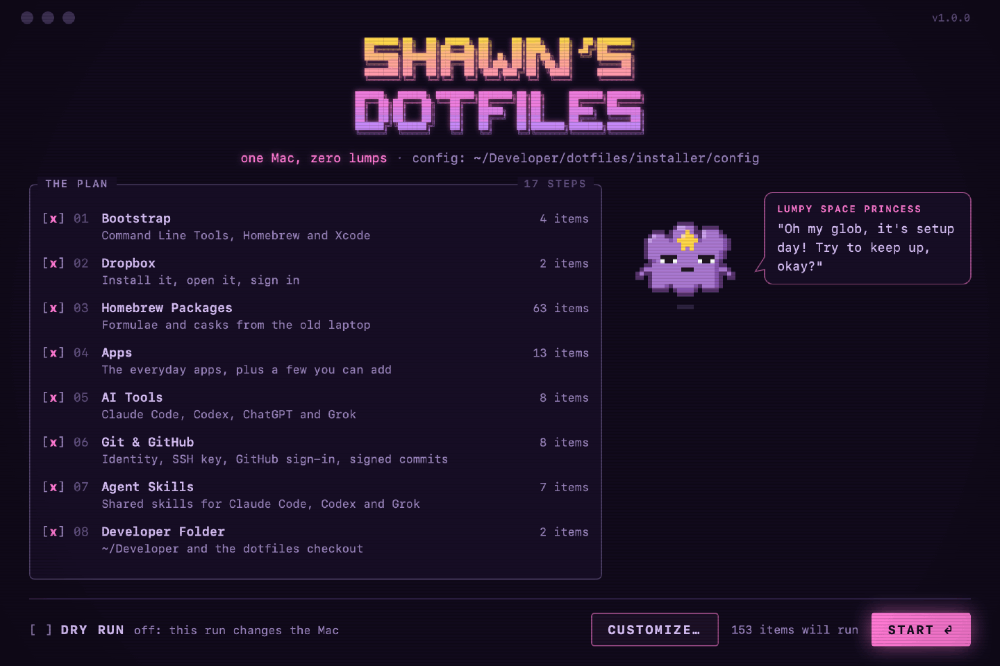
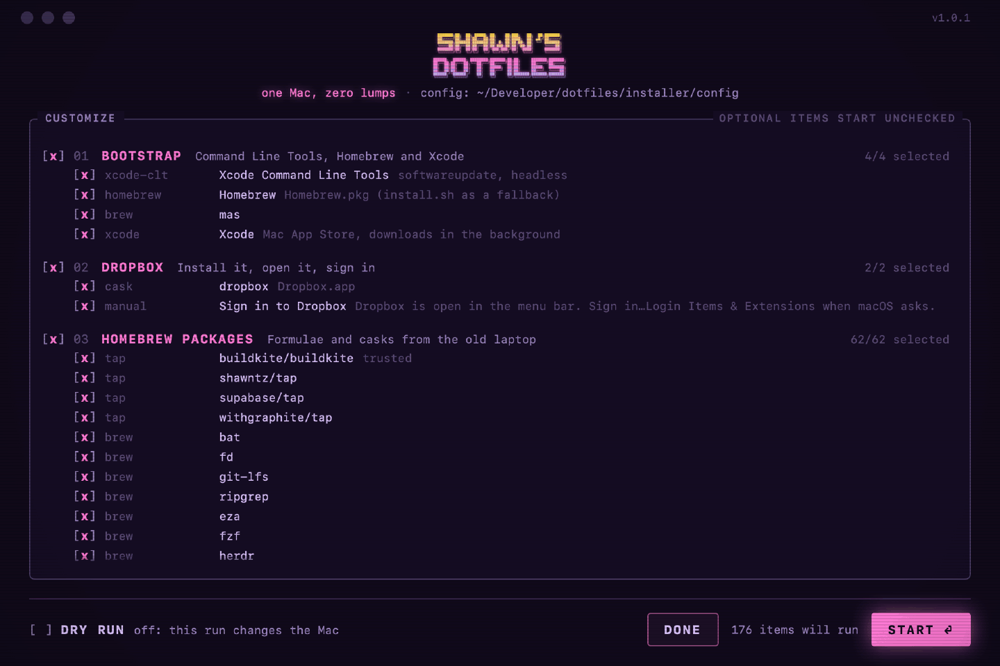

<p align="center">
  
</p>

<h1 align="center">Shawn's Dotfiles</h1>

<p align="center">one Mac, zero lumps</p>

<p align="center">A Mac app and a command line tool that set up a new Mac from a folder of YAML files. Fork it and change the YAML to set up yours.</p>

<p align="center">
  <a href="https://github.com/shawntz/dotfiles/actions/workflows/installer.yml"></a>
  
  <a href="LICENSE"></a>
</p>



Lumpy Space Princess (LSP) from Adventure Time narrates, and each step puts one of eight [fan-made](#fan-art) pixel-art characters on screen. The GIF uses sample data.

## What it does

Open the app on a new Mac and press START. It installs Apple's Command Line Tools and Homebrew first. Xcode is huge, so it downloads in the background while my apps, Homebrew packages and AI tools install.

The app makes an SSH key, signs in to GitHub and turns on commit signing. It writes my shell, editor, terminal and keyboard config and sets macOS preferences. You end on a checklist of what only you can do, such as logging out so the new key repeat takes effect.

Most items check what is already there, so a second run only does what is missing. In a terminal, `shawn install` runs the same steps from the same YAML.

## Try it

It runs on macOS 27 or later, which means an Apple silicon Mac.

Download the disk image from the [releases page](https://github.com/shawntz/dotfiles/releases), open it and drag Dotfiles onto Applications. If macOS refuses to open the app, click Open Anyway in System Settings, under Privacy & Security.

The app changes nothing until you press START. Turn on DRY RUN first to see what each item would do.

With Xcode 27 or later, you can build it from a checkout instead:

```sh
git clone --depth=1 https://github.com/shawntz/dotfiles.git
cd dotfiles/installer && make run
```

`make run` builds the app and opens it in demo mode, a dry run that treats your Mac as new and starts by itself.

## Run it for real

A real run makes your Mac match this config. You get my apps, key remaps, shell and macOS settings, and a Dock that keeps only six apps and your `~/Developer` folder. There is no uninstall. Files it replaces go to `~/.shawn/backups/<run>/`. Fork it and [change the config](#make-it-yours) before you run it on a Mac you care about.

## When it needs you



The config ships no name or email. The app asks for yours once and keeps the answers in `~/.shawn/answers.json`. It asks for your admin password once per run. A script can't sign in to the App Store, so the app asks you to sign in yourself or skip the App Store apps. For GitHub, it shows a one-time code and opens the page where you paste it.

> "Your name, not mine. Putting mine on your commits would be so awkward."\
> LSP, when the installer asks a question

## The config

Everything the installer does lives in [`installer/config`](installer/config). A step is one file in `steps/` with a title and a list of items. Here is `steps/13-webapps.yaml` without its comments:

```yaml
id: webapps
title: Web Apps
subtitle: Websites as standalone apps
mascot: bubblegum

items:
  - webapp: Carbon
    url: https://my.carbonapp.co
  - webapp: X
    url: https://x.com
```

A `webapp:` item builds an app in `/Applications` with its own window, Dock icon and sign-in. `mascot: bubblegum` puts Princess Bubblegum on screen for that step.

An item starts with its kind and the thing it acts on. These lines come from other steps, and the comments are mine:

```yaml
- brew: ripgrep
- cask: slack
  app: Slack.app                # a Slack.app already in /Applications counts as installed
- mas: 937984704                # the App Store id
  name: Amphetamine
- ssh-key: ~/.ssh/id_ed25519    # never overwrites a key
- manual: Log out and back in   # a line on the checklist at the end
```

This config has 176 items in 17 steps. The CUSTOMIZE… screen has a checkbox for each step and item, and they all start checked. The manual lists all [29 item kinds](installer/README.md#item-kinds).

## Make it yours

Fork the repo. You never edit Swift.

1. Clone your fork to `~/Developer/dotfiles`. That is where `shawn` looks for the repo.
2. In `installer/config/installer.yaml`, point `remote.repo` and `vars.dotfiles_repo` at your fork and set `vars.github_user` to your GitHub username. Change `name:` and `tagline:` while you're there. The banner in the window is the ASCII art in `fun/header.txt`.
3. Delete what you don't want from `steps/`, and put your own dotfiles in `files/`.
4. If the Mac you use now runs macOS 27 or later and has Xcode 27 or later, copy its packages into the config. Run `swift build` in `installer/`, then `.build/debug/shawn drift --write --repo ~/Developer/dotfiles`. That adds a line to the step files for each Homebrew, App Store and npm package the config lacks.
5. In `installer/`, run `make validate` to check the config, then `make run` to watch it in a dry run.
6. Push to `master` on your fork. The app you build in the next step fetches its config from there when it starts. The one on my releases page fetches mine.
7. Run `make app SIGN_IDENTITY=-` in `installer/`. It builds `build/Dotfiles.app`, signed ad hoc. Copy it to the new Mac and open it. If macOS refuses, use Open Anyway as in [Try it](#try-it).

> "Copying your old laptop's taste. It had good taste. Like me."\
> LSP, during the packages step

Some names live in the Swift code and stay mine after a fork: the `shawn` command, the `~/.shawn` and `~/.config/shawn` folders, the `~/Library/Logs/ShawnsDotfiles` log folder and the `com.shawnschwartz` bundle ids.

## The `shawn` command

The installer puts `shawn` in `~/.local/bin`. `shawn` has 34 commands, and [`cli.yaml`](installer/config/cli.yaml) defines 14 of them. Adding one takes a few lines of YAML and no rebuild. This one is a made-up example:

```yaml
commands:
  hello:
    section: Fun
    summary: Say hello
    run: echo "hello, $1"
```

`shawn` can also edit the config:

```sh
shawn add cask figma --pr
```

That installs Figma, adds its line to `steps/04-apps.yaml`, commits it on a branch, pushes and opens a pull request. After the merge, every Mac with `shawn` pulls the change on its next command, and `shawn install` installs it there. A new Mac fetches it when the app starts.

`shawn help` lists every command. The [manual](installer/README.md) covers every built-in command and flag, how `shawn` updates itself, and how to build, sign and release the app.

## Fan art

Lumpy Space Princess, Finn, Jake, BMO, Princess Bubblegum, Marceline, the Ice King and Gunter appear here as fan art. Each one is original pixel art in the style of Adventure Time. Adventure Time and its characters are © Cartoon Network. This project is fan-made and not affiliated with Cartoon Network. LSP's lines on this page are original lines in her voice, not quotes from the show.

## License

MIT. See [LICENSE](LICENSE).
