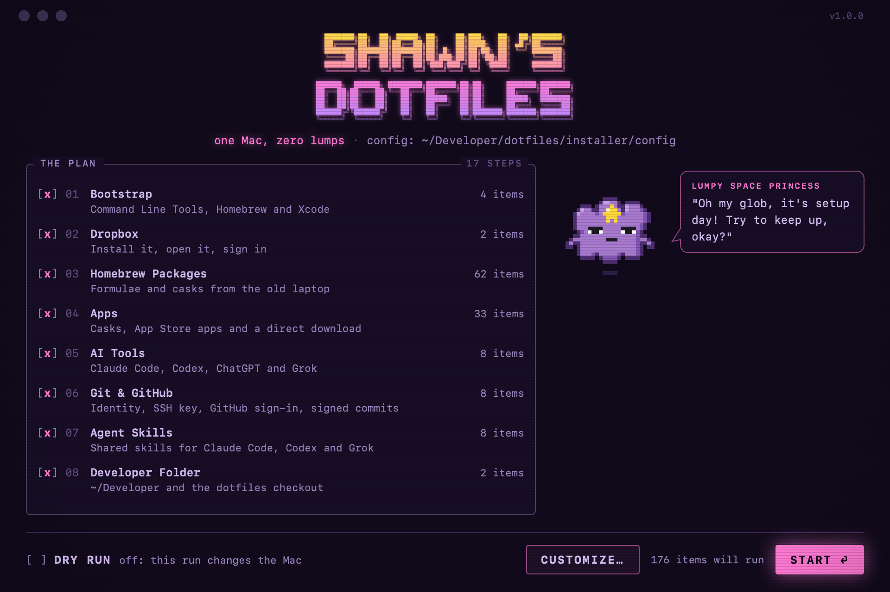
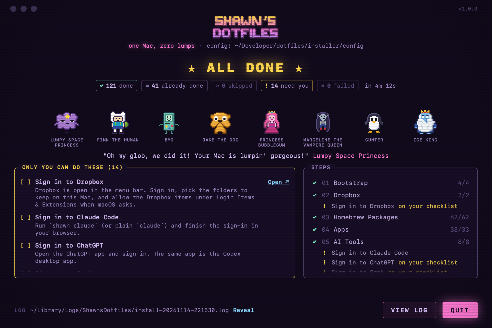

# Shawn's Dotfiles

A Mac app that sets up a brand-new Mac the way Shawn's laptop is set up. It installs Homebrew, Xcode, apps and AI tools, sets up git and an SSH key, and writes the shell and keyboard config, macOS settings and the Dock. Small YAML files under `config/` declare everything it does. A command line tool, `shawn`, runs the same installer in the terminal and pulls config changes from GitHub before each command, so every Mac stays in step with the repo.

- [Set up a new Mac](#set-up-a-new-mac)
- [Change something](#change-something)
- [Item kinds](#item-kinds)
- [The shawn command](#the-shawn-command)
- [How changes reach your other Macs](#how-changes-reach-your-other-macs)
- [Build, sign, notarize, release](#build-sign-notarize-release)
- [Development](#development)
- [Fan art](#fan-art)

## Set up a new Mac

### Download and open

The app and `shawn` run on macOS 27 or later. An older macOS refuses to open the app. `shawn` checks the macOS version itself, and on an older one it prints `shawn needs macOS 27 or later` and exits with status 69. macOS 27 runs only on Apple silicon, so there is no Intel build.

A workflow builds a release for each new version on `master`. It publishes the release once the repository can sign and notarize it, or allows builds that are not notarized (see [Releasing](#releasing)). When the [releases page](https://github.com/shawntz/dotfiles/releases) has one:

1. On the new Mac, open the releases page and download `ShawnsDotfiles-<version>.dmg` from the newest `shawn-v…` release.
2. Open the disk image and drag Shawn's Dotfiles onto the Applications shortcut.
3. Open it from Applications. macOS asks once whether to open an app downloaded from the internet. Choose Open. If macOS refuses to open it, the release is not notarized, and [If macOS won't open it](#if-macos-wont-open-it) has the fix.

When the page has none, build the app from a checkout with Xcode 27 or later, using `make app SIGN_IDENTITY=-` (see [Build, sign, notarize, release](#build-sign-notarize-release)), copy `build/Shawn's Dotfiles.app` to the new Mac and open it there.



The welcome screen shows where the config came from. On a new Mac with a network connection it reads `config: shawntz/dotfiles@master (abc1234)`. That means the app fetched the newest config from GitHub, so a disk image from months ago still installs today's setup, unless that config needs a newer app. Offline, it reads `config: bundled with the app` and uses the copy inside the app. Run from a checkout, as in the picture, it reads that config folder's path.

Press START to run everything, or CUSTOMIZE… to pick steps and items first. Optional items start unchecked. With DRY RUN switched on, the run shows what each item would do and changes nothing. A finished dry run opens on its log, and RUN FOR REAL… takes you back to the start screen with DRY RUN off and the same selection. Nothing changes until you press START.

A real run holds off idle sleep until it ends, so the Mac does not go to sleep part-way through an unattended install. The display can still turn off.

### What it asks you for

- Your name and email address for Git. The first run that includes the git step asks for them before the admin password, offering the name and email that git on this Mac already has, and keeps your answers in `~/.shawn/answers.json`. Later runs reuse them. `shawn install --ask`, or the app started with `--ask`, asks again and offers the saved answers. Skipping a question asked again keeps its saved answer. If you skip a question that has no answer yet, the items that need it wait instead of running: the git identity, the SSH key, commit signing and the reminder to check your email on GitHub. On a Mac without the SSH key yet, the GitHub sign-in waits too, because it uploads that key. They count as needing you, not as failed, and the checklist says how to answer. A dry run asks nothing and shows the offered answer, or a placeholder, in its place.
- Your admin password, once. When a selected item needs admin rights, the app asks before the first step starts and reuses the password for the rest of the run. Only the commands of these items can use it, and only while they run: the Command Line Tools, Rosetta, Homebrew, casks, App Store apps, Xcode, `.pkg` downloads and items marked `sudo: true`. No other item, and no other program on the Mac, gets the password. If you cancel, the run carries on and the steps that need admin rights fail. RETRY FAILED asks again.
- The App Store. macOS has no way to sign in to the App Store from a script. Before the first App Store install (Xcode, then Amphetamine), the app asks you to sign in to the App Store app and choose "I'm signed in" or "Skip App Store apps". If nobody answers within ten minutes, the run skips App Store apps. Every skipped App Store app goes on the checklist with a link to its store page, whether you chose to skip or nobody answered. While `mas` installs an app, macOS may ask for your Apple Account password or Touch ID. The app stops a `mas` install that is still running after 30 minutes and puts that app on the checklist.
- A GitHub code. The git step signs in to GitHub with the `gh` CLI. A banner shows a one-time code in large type, copies it to the clipboard and opens github.com/login/device. Paste the code there and approve. The app then uploads your new SSH key for pushing and for commit signing. If you do not finish signing in within 15 minutes, the item stops waiting and adds a checklist entry.

Xcode downloads in the background while the other steps run. Before the download starts, the app makes the Command Line Tools the active developer folder, unless you already selected a full Xcode. When Xcode lands, the app accepts its license right away, because Homebrew refuses to run while the selected Xcode has a license nobody accepted. If `mas` is still downloading after four hours, the app stops it, opens Xcode's App Store page and adds a checklist entry.

The last step waits for Xcode, up to three hours by default. It then accepts the license if that is still needed, runs Xcode's first-launch setup and selects it with `xcode-select`. If you selected another full Xcode yourself, such as a beta, that one stays selected and the app sets up `/Applications/Xcode.app` next to it. If Xcode never arrives, you get a checklist entry, not a failure.

### What you still do by hand



Some steps only a person can do. The app adds each one to a checklist on the final screen, with an Open button that goes to the right place in System Settings or on the web. A reminder with a `check:` (for example, whether Karabiner has Accessibility access) comes back on later runs until its check passes. The app shows a reminder without one once per Mac, records it in `~/.shawn/state/reminders.json`, and shows it again on a run with `--fresh`. Later runs before you quit the app, such as RETRY FAILED or RESUME, list it again.

- Allow Karabiner-Elements' background services and driver extension, and give it Accessibility access. If its window still says keyboard input is blocked, give it Input Monitoring access too.
- Give Hammerspoon Accessibility access.
- Sign in to Dropbox, 1Password, Slack, Spotify, Claude Code, Codex, ChatGPT, Grok and the other apps, and enter the licenses for paid apps such as Middle and Superkey.
- Log out and back in so the key repeat, trackpad and menu bar settings take effect.
- Anything your employer manages, such as a VPN, device management or their certificates. None of that is in this config on purpose.

If something fails, the final screen lists it with the error and a RETRY FAILED button. Every item checks what is already done, so a retry only redoes what is missing. The bottom of the screen names the log file, `~/Library/Logs/ShawnsDotfiles/install-<date>-<time>.log`. A dry run writes no log file. VIEW LOG shows the run's log on screen, with a COPY button.

STOP ends a run cleanly. The app marks the item that was running as stopped, not failed, and RESUME runs the same selection again, skipping what is already done.

### If macOS won't open it

A release that carries a Developer ID signature and Apple's notarization ticket opens normally. Gatekeeper blocks every other build that another Mac downloaded or received by AirDrop. That is a build signed ad hoc (see [signing](#signing)) and a release whose notes say that Apple has not notarized it. To open one anyway, try to open it once, then go to System Settings, Privacy & Security, and click Open Anyway.

On a Mac running macOS 27 or later with Xcode 27 or later, you can also build and run it from a checkout:

```sh
git clone https://github.com/shawntz/dotfiles.git ~/Developer/dotfiles
cd ~/Developer/dotfiles/installer
make app SIGN_IDENTITY=-
open "build/Shawn's Dotfiles.app"
```

After the first run, `shawn install` runs the same installer in the terminal.

## Change something

The config lives in `config/`:

```
config/
  installer.yaml        name, tagline, where newer config comes from, {{vars}}, the questions it asks
  steps/NN-name.yaml    one file per step, run in filename order
  files/                files that copy: and json-merge: items install
  skills/<name>/        agent skills bundled with the installer
  webapp-icons/         icons for web apps (optional)
  cli.yaml              the shawn command's own settings and YAML commands
  fun/                  the ASCII header, LSP quotes, pixel sprites, your own images
```

The steps are `01-bootstrap`, `02-dropbox`, `03-packages`, `04-apps`, `05-ai`, `06-git`, `07-skills`, `08-developer`, `09-shell`, `10-keyboard`, `11-terminal`, `12-claude`, `13-webapps`, `14-cli`, `15-macos`, `16-dock` and `17-finish`.

A step file has an `id:` (lowercase letters, digits and dashes; `shawn install --only` and `--skip` use it), a `title:` and an `items:` list. `subtitle:`, `mascot:` and `quips:` are optional, and `enabled: false` leaves the whole step unchecked. A file whose name starts with `_` or `.` is skipped.

Each item in a step file is one line or a short block. Its first key is its kind and that key's value is the main thing it acts on. Every item also accepts `name:` (display name), `note:` (shown next to it) and `optional: true` (unchecked until you switch it on). A misspelled key is an error, and the message suggests the key you probably meant.

Check your edit before you commit it:

```sh
shawn config validate        # or, in installer/: make validate
```

### Names git will not commit

The repository's root `.gitignore` is older than the installer and applies inside `installer/config/` too. It hides a folder called `icons` (on a Mac its `Icon?` rule matches that name), `*.log` and `*.lock` files, and folders called `build`, `target` or `dist`, among others. git skips those files without any message, so a commit or `shawn pr` leaves them out and they never reach GitHub or your other Macs. That is why web-app icons go in `webapp-icons/`.

`make validate` and CI fail when git would ignore a file in `config/`, and they name the rule that hides it. The test suite checks the same when it runs inside the git checkout. Rename the file, move it, or add a `!` exception for its folder to `installer/.gitignore`, such as `!config/files/**`. An exception for the file alone does not help when a rule hides a folder above it, because git never looks inside an ignored folder.

### A command line tool

`steps/03-packages.yaml`. Third-party formulae use their full name.

```yaml
  - brew: ripgrep
  - brew: supabase/tap/supabase
```

### An app from Homebrew

`steps/04-apps.yaml`. With `app:`, a copy already in /Applications counts as installed.

```yaml
  - cask: notion
    app: Notion.app
```

### An App Store app

`steps/04-apps.yaml`. The number is the id in the app's App Store URL. `name:` must match the app's name in /Applications, because the installer looks for the App Store receipt inside that app.

```yaml
  - mas: 1289583905
    name: Pixelmator Pro
```

### A web app

`steps/13-webapps.yaml`. The app gets its own window, Dock icon and sign-in. Without `icon:` it uses the site's own icon. For your own icon, put a PNG, JPEG or ICNS file in `config/webapp-icons/` and name it relative to `config/`:

```yaml
  - webapp: Linear
    url: https://linear.app
    icon: webapp-icons/linear.png
```

### A Claude Code spinner phrase

`files/claude/spinner-verbs.yaml`. Add a line to `verbs:`. Step 12 writes the whole list into `~/.claude/settings.json`, replacing the list that is there.

```yaml
spinnerVerbs:
  mode: replace
  verbs:
    - "Nyooming (at considerable speed)"
    - "Lumping (respectfully)"
```

### An app in the Dock

`steps/16-dock.yaml`. Put the app's name where you want it in the row. The installer skips an app that is not installed and logs a warning.

```yaml
      apps:
        - Google Chrome
        - Cursor
        - Slack
```

Before it changes the Dock, the installer saves the old layout to `~/.shawn/backups/<run>/Library/Preferences/com.apple.dock.plist`. To go back, run `defaults import com.apple.dock` with that file, then `killall Dock`.

### A macOS setting

`steps/15-macos.yaml`. Change the setting in System Settings, find its domain and key with `defaults read`, then add it. `restart:` names the processes that need restarting to pick it up.

```yaml
  - defaults: com.apple.screencapture
    set:
      disable-shadow: true
    restart: [SystemUIServer]
```

### A shawn command

`cli.yaml`, under `commands:`. `run:` is a bash script (macOS bash 3.2), and your arguments arrive as `"$@"`. Use `exec:` instead to replace `shawn` with another program, as `shawn claude` does. The comment at the top of `cli.yaml` lists every key a command takes and the variables a script gets. `$SHAWN_CONFIG` is the config folder in use. `$SHAWN_CONFIG_EXPLICIT` holds the folder you gave with `--config` and is unset otherwise, so a script that runs `shawn` again can pass the same choice on.

```yaml
commands:
  weather:
    section: Fun
    summary: The weather where you are
    run: curl -fsS "https://wttr.in/${1:-}?format=3"
```

Once it is merged, `shawn weather` works on every Mac on its next `shawn` call (see [how changes reach your other Macs](#how-changes-reach-your-other-macs)).

### A question the installer asks

`installer.yaml`, under `ask:`. Steps use the answer like any variable, here `{{editor_theme}}`. A run asks a question only when an item it runs mentions the variable, and asks in the order of the list.

```yaml
ask:
  - var: editor_theme
    prompt: Which theme should the editor use?
    default: dark
```

`var:` and `prompt:` are required. `default:` is the answer offered, and it may use other variables. `default_command:` is a `/bin/sh` line whose first line of output is offered instead, when that line passes `format:`. It runs as you, in dry runs too, so it must only read, and it gets 5 seconds. `format: email` turns down a reply that does not look like an address and asks again with the reason, three times at most. Every format also turns down a reply with a tab or an escape code. An arrow key at the terminal prompt types one. A name under `vars:` cannot also be asked, and neither can a built-in one. `shawn config answers` lists the questions and the answers saved on this Mac.

A YAML command in `cli.yaml` may use an answer too, also through a `vars:` entry, and it refuses to run while that answer is missing. Set an answer that only `cli.yaml` uses in `~/.shawn/answers.json`, because no run asks it.

### A setting for one Mac only

Keep it out of the repo. The installed `~/.zshrc` reads `~/.zshrc.local` near its end, and nothing in this config writes that file. The git step includes `~/.gitconfig.local` at the end of your global git config, so that file overrides every git setting the step writes, signing included.

### Open a pull request

For packages and web apps, `shawn add` installs it now and writes its line into the right step file for you. The `add:` map in `cli.yaml` lists the kinds you can add (`tap`, `brew`, `npm`, `cask`, `mas`, `webapp`) and the file each goes to. The new line goes next to the items of the same kind, in alphabetical order when those are sorted. Any `--option value` after the name becomes that option in the YAML. A new cask gets its `app:` from Homebrew when the casks in that file name their apps. If any step file already declares the package, `shawn add` still installs it but adds no line.

`--pr` then makes a branch, commits that one file, pushes it and opens the pull request with `gh`. If the commit, the push or `gh pr create` fails, `shawn` switches back to the branch you started on and says where your change is. `--dry-run` shows what would happen. `shawn add` works in the checkout named in `~/.config/shawn/config.yaml`, or in the one you give with `--repo PATH`.

```sh
shawn add brew ripgrep --pr
shawn add cask notion --pr
shawn add mas 1289583905 --name "Pixelmator Pro" --pr
shawn add webapp Linear --url https://linear.app --pr
shawn add cask figma --no-install      # only write the YAML line
```

For anything you edited by hand, `shawn pr -m "Add weather command"` opens a pull request with everything uncommitted under `installer/config`.

`shawn drift` lists what Homebrew, the App Store and npm have on this Mac that the config does not declare, with the YAML to add, and what the config declares that this Mac lacks. It lists apart the apps that are in place but did not come from Homebrew, because `brew upgrade` does not update them. `shawn drift --write` adds the missing lines to the step files that `add:` names.

CI builds, tests and validates the config on every pull request that touches `installer/`.

## Item kinds

`shawn config kinds` prints every kind with a summary and an example, generated from the code. If this table and that list disagree, the list is right.

Any text option may use `{{variables}}`. These are the ones under `vars:` in `installer.yaml` and the answers to its `ask:` questions, plus `{{home}}`, `{{user}}`, `{{hostname}}`, `{{arch}}`, `{{brew_prefix}}`, `{{applications}}`, `{{state_dir}}` (`~/.shawn`) and `{{config_dir}}`. Any path may start with `~`.

### Packages

Everything that runs `brew` needs the `homebrew` item to have worked first.

| kind | value | options | what it does |
|---|---|---|---|
| `xcode-clt` | `install` | none | Installs the Xcode Command Line Tools through `softwareupdate`, falling back to Apple's install dialog. Needs the admin password. |
| `homebrew` | `install` | `method: pkg` (default) or `script` | Installs Homebrew from its signed `Homebrew.pkg` after checking the signature. When the package fails, it runs the official `install.sh` instead. Then runs `brew update`. Needs the admin password. |
| `rosetta` | `install` | none | Installs Rosetta 2, which runs apps and tools built only for Intel. Needs the admin password. |
| `xcode` | `download` or `finish` | `timeout_minutes` (finish; default 180), `platforms: [iOS, watchOS, tvOS, visionOS]` (finish) | `download` asks the App Store question, keeps the Command Line Tools selected, starts Xcode downloading in the background with `mas` and moves on. It accepts the license as soon as Xcode lands. `finish` waits for Xcode, accepts the license, runs the first-launch setup, selects Xcode unless you selected another full Xcode, and installs any simulator `platforms`. If Xcode never arrives you get a checklist entry, not a failure. |
| `tap` | `user/repo` | `trusted: true\|false` (default false), `url:` | `brew tap`, from `url:` when given. `trusted: true` also runs `brew trust`. |
| `brew` | formula, `user/tap/name` for a third-party tap | `args: […]` | `brew install --formula`. |
| `cask` | cask token | `args: […]`, `app: Name.app`, `launch: true\|false` (default false; needs `app:`) | `brew install --cask`. With `app:`, an app already in /Applications counts as installed. `launch: true` opens it afterward. |
| `mas` | App Store id | `name:` (required; the app's name in /Applications) | Installs from the App Store with `mas install`, falling back to `mas get`, after asking once per run whether you are signed in. Stops each `mas` command after 30 minutes. A skipped, failed or stopped install adds a checklist entry that links to the app's store page. |
| `npm` | package name | none | `npm install -g`. |
| `download` | URL of a .dmg, .zip or .pkg | `app: Name.app`, `type: auto\|dmg\|zip\|pkg`, `to:` (default /Applications), `sha256:`, `team_id:`, `verify: true\|false` (default true), `replace: true\|false` (default false), `launch: true\|false` | Downloads the file, checks `sha256` and the Developer ID signature and team, then copies the app into place or runs the package installer. An app already there counts as done unless `replace: true`, which moves the old copy to the backup folder and installs it again on every run. A `.pkg` with no `app:` also installs again on every run, because nothing names the app to look for. |
| `script` | display name | `run:` (required), `check:`, `creates:`, `shell: bash\|zsh\|sh`, `sudo: true\|false`, `env: {K: V}`, `cwd:`, `timeout:` (seconds) | Runs a shell script (bash and zsh with `set -euo pipefail`). It counts as done when the `creates:` path exists and `check:` exits 0. Give either or both. With neither, it runs every time and `shawn doctor` cannot check it. `sudo: true` runs the whole script as root; without it, the script cannot use the admin password. |

### Files and settings

| kind | value | options | what it does |
|---|---|---|---|
| `copy` | file or folder under `config/files/` | `to:` (required; a trailing `/` copies into that folder), `mode: "0600"`, `backup: true\|false` (default true), `replace: true\|false` (folders; default false), `if_missing: true\|false`, `template: true\|false`, `exclude: [names]` | Copies it into place and backs up whatever it replaces. Done when the destination already matches. `template: true` fills in `{{variables}}` inside the file. Without `mode:`, a file gets the permissions it has in `config/files/`. A folder payload merges into what is there, and with `replace: true` the item also removes files the payload folder lacks. It never copies or removes names in `exclude:`, `.git`, `.gitkeep` or `.DS_Store`. It never copies a file over a folder. A file payload fails instead and suggests `to: <folder>/`. A folder payload fails when one of its files would land on a folder, unless `replace: true`, which replaces that folder. |
| `symlink` | link path | `to:` (required; written as given, may be relative) | Makes a symbolic link. |
| `mkdir` | folder | `mode:` | Makes a folder. A link to a folder counts as the folder, and `mode:` leaves the folder it points to alone. |
| `json-merge` | JSON file to change | `values:` (inline), `from:` (YAML or JSON file under `config/files/`), `arrays: replace\|union` (default replace), `create: true\|false` (default true) | Merges keys into a JSON file, keeping its key order and every key you did not mention. Refuses to touch a file that is not valid JSON. |
| `defaults` | preference domain, such as `NSGlobalDomain` | `set:` (required; key and value, or `{type: float, value: 128}` to force a type), `current_host: true\|false`, `restart: [Dock, Finder, …]`, `sudo: true\|false` | Writes macOS preferences. Restarts the listed processes only when something changed. |
| `dock` | a block of options | `apps:` (names, paths or `{app: …, fallback: …}`), `folders:` (`{path:, view: auto\|fan\|grid\|list, display: folder\|stack, sort: name\|added\|modified\|created\|kind}`), `settings:` (Dock preferences), `clear: true\|false` (default true) | Lays out the Dock in the listed order and restarts it once. Skips apps that are not installed, with a warning. When several apps of one `{app:, fallback:}` entry are installed, the one already in the Dock stays. With `clear: true`, it removes everything not listed. Before it writes, it saves the old Dock preferences to the backups. |
| `open` | app name, path or URL | `background: true\|false` (default true), `args: […]` | Opens it. Runs every time, and `shawn doctor` cannot check it. |
| `manual` | something only you can do | `detail:`, `url:`, `check:` | Adds an entry to the checklist on the final screen, with an Open button for `url:`. With `check:`, the entry stays off once the check exits 0. Without one, the entry appears once per Mac and is recorded in `~/.shawn/state/reminders.json`; `--fresh` shows it again. The record knows a reminder by its text, `detail:` and `url:`, so editing any of them shows it once more on every Mac. Never fails. |
| `login-item` | app name or path | `bundle_id:` | Opens the app at login through a launch agent in `~/Library/LaunchAgents`. Does not open it now. |
| `shawn-cli` | `install` | `to:` (default `~/.local/bin`), `repo:` (default `~/Developer/dotfiles`) | Installs the `shawn` command, the web-app shell in `~/.shawn/bin`, a copy of the config in `~/.shawn/config`, `~/.config/shawn/config.yaml` and zsh completions. When the binary changes, it records in `~/.shawn/state/cli.json` which sources the new binary came from, read from the app's `build-info.json`. |

The installer moves the files it replaces to `~/.shawn/backups/<run>/` first, where `<run>` is the date and time the `shawn` command or the app started. A `copy:` item can turn that off with `backup: false`. If the folder an item writes into is a symbolic link, as in a stow-style dotfiles setup, the installer replaces the link with a real folder holding the same files and moves the link to the backups. The write then never lands in the folder the link pointed to. It refuses a linked folder with more than 2,000 files or 64 MB, and says so. A backup whose spot in the backups is taken gets a numbered name next to it, such as `config.2`. A backup whose path there runs through a link already moved to the backups goes into a numbered folder next to that link, such as `.config/ghostty.2/config`.

### Git, GitHub and agents

| kind | value | options | what it does |
|---|---|---|---|
| `git-config` | a block of `key: value` | none | `git config --global` for each one, keeping every value already there. A key that holds a list (`url.*.insteadOf`, `safe.directory`, `credential.helper` and others) gets the value added. A key someone set several times gets the value added after the others, never collapsed into one. It logs a single value before replacing it. An include (`include.path`, `includeIf.*.path`) stays at the end of the file, so the included file overrides everything above it. |
| `ssh-key` | private key path, such as `~/.ssh/id_ed25519` | `type: ed25519\|ecdsa\|rsa` (default ed25519), `comment:` (default `{{email}}`), `config: true\|false` (default true), `hosts: [github.com]` | Makes the key if it does not exist; never overwrites one. Keeps a marked block in `~/.ssh/config` that adds the key to the agent and keychain, plus a stanza per host. It adds the block at the end, later updates it wherever it is, and keeps everything outside it byte for byte. ssh uses the first value it finds, so settings you already have in the file win. |
| `github` | host, such as `github.com` | `protocol: ssh\|https` (default ssh), `scopes: […]`, `key:` (public key), `upload: [authentication, signing]`, `title:` (default `{{hostname}}`), `known_hosts: true\|false`, `setup_git: true\|false` (both default true) | Signs in with `gh auth login --web` and shows you the one-time code, uploads the SSH key for each `upload` type, adds the host to `known_hosts` and runs `gh auth setup-git`. Stops waiting after 15 minutes and adds a checklist entry. |
| `git-signing` | public key path | `email:` (default `{{email}}`), `commits: true\|false`, `tags: true\|false` (both default true) | Signs commits and tags with that SSH key and keeps `~/.config/git/allowed_signers` current. |
| `clone` | `owner/repo` or a git URL | `to:` (required), `protocol: ssh\|https` (default ssh when `gh` is signed in over ssh, else https), `branch:` | Clones the repo unless `<to>/.git` exists. Refuses a folder that has files but is not a repo. Gives up after 30 minutes, or after 2 minutes without data, and removes the half-finished clone. |
| `skill` | skill name | `from:` (bundled; default `skills/<name>`), `source: owner/repo` (from GitHub), `agents: [claude, codex, grok]` (default all), `replace_existing: true\|false` (bundled only; default false) | Copies a bundled skill to `~/.agents/skills/<name>` and links it into `~/.claude/skills` and `~/.grok/skills`. Codex reads `~/.agents/skills` itself. Your own copy at one of those links stays as it is, and the item adds a checklist entry. Your own copy is a git checkout, a folder holding an edited or extra file, or a link to either. With `replace_existing: true`, the item moves such a folder to the backups instead, or points such a link at the bundled copy. Any other folder there, such as an older copy whose every file matches the bundle, goes to the backups and the link takes its place. `npx skills add` installs a `source:` skill. |
| `claude-plugin` | `name@marketplace` | `marketplace: owner/repo`, `scope: user\|project\|local` (default user) | `claude plugin install`, adding the marketplace first when it is new. |

### Web apps

| kind | value | options | what it does |
|---|---|---|---|
| `webapp` | app name, such as `X` | `url:` (required, https), `icon:` (a PNG, JPEG or ICNS file in `config/webapp-icons/`, written `webapp-icons/<file>`, or the https address of such an image), `to:` (default /Applications), `bundle_id:`, `user_agent:`, `width:`, `height:`, `hosts: […]` | Builds `<Name>.app` around the bundled web-app shell, with its own window, sign-in, downloads and camera and microphone prompts. Links to other sites open in your browser; `hosts:` lists extra sites that stay inside. A link to another app, such as a `zoommtg:` link, opens right away only when you click it in the page itself. The web app asks first when you click one inside an embedded frame, such as an ad, whatever the link's target, and when the page opens one from a script. A script in an embedded frame cannot open another app at all. The icon is yours, else the site's own, else a letter tile. If the image at an `icon:` address cannot be downloaded or used, such as an SVG, the app gets a stand-in icon and the item asks for attention on every run until it works. |

## The shawn command

The installer puts `shawn` in `~/.local/bin`. Run `shawn` on its own for the full list, including the YAML commands from `cli.yaml`, and `shawn help <command>` for one command's options.

| command | what it does |
|---|---|
| `shawn`, `shawn help [command]` | The banner, a quip from LSP, and every command by section. |
| `shawn version` | Version, where the config comes from, the checkout path and when it last checked for updates. |
| `shawn install` (or `shawn sync`) | Runs the installer in the terminal. `--dry-run` (`-n`), `--only step,…` and `--skip step,…` (step ids such as `packages`), `--yes` (`-y`), `--ask`, `--fresh`, `--config DIR`, `--no-remote`. It asks before it starts, and without a terminal it needs `--yes`. Then it asks the config's questions that the chosen steps need and that have no saved answer, with the offered answer in brackets. Return takes it, and Return with nothing offered skips the question. `--ask` asks them all again. With `--yes`, every question takes its default answer, which for the App Store question is "I'm signed in". It asks for the admin password itself only when an item needs it, never in a dry run. The first Ctrl-C stops the item in progress and prints the summary, also while a question or password prompt is open. A second Ctrl-C quits at once. Exits 0 when nothing failed, 1 when something did and 130 when stopped. It does not keep the Mac awake, so run a long install as `caffeinate -i shawn install`. |
| `shawn doctor` | Checks this Mac against the config without changing anything. It checks every enabled item, plus Homebrew, git identity, GitHub sign-in, an SSH key and `~/.local/bin` on `PATH`. It lists the items it cannot check (`open:`, a `manual:` without `check:`, a `script:` with neither `check:` nor `creates:`) apart under "Can't be checked" and never counts them as missing. An item that waits for an answer this Mac has not saved goes there too, with the question. Doctor never asks. Exits 1 if anything is missing. |
| `shawn drift [--write] [--repo PATH]` | What Homebrew, the App Store and npm have on this Mac that the config does not list, with the YAML to add, and the other way around. `--write` adds the missing lines to the step files in the checkout. |
| `shawn add <kind> <name> [--option value …] [--no-install] [--pr] [--dry-run] [--repo PATH]` | Installs it and adds its YAML line. `--pr` opens a pull request. |
| `shawn pr [-m message] [--repo PATH]` | Opens a pull request for your uncommitted config changes. |
| `shawn update [--check] [--rebuild]` | Runs the update check [described below](#how-shawn-updates-itself) now, explaining each step, whatever `self_update.mode` says. `--check` only reports, takes no lock, writes nothing and fetches no commits. Without a checkout it reads the newest release's `shawn-cli.json`, a few hundred bytes, to learn which macOS that release needs. With one, it can tell that your local commits and the remote's new commits have diverged only once an earlier run has fetched those new commits. `--rebuild` rebuilds `shawn` from the checkout even when the record says it is current. Exits 0 when everything is current afterward, or with `--check` when the update could go ahead. Exits 69 when GitHub cannot be reached, and 1 otherwise. |
| `shawn upgrade [name …] [--list]` | Runs the upgrades listed under `upgrade:` in `cli.yaml` (Homebrew, App Store apps, Claude Code, Codex, Grok, skills and more) and reports each one. Name entries to run only those; `--list` shows them. |
| `shawn config [path\|show\|validate [DIR]\|kinds\|answers\|edit\|brewfile]` | Where the config is, the plan, a check that lists every problem, the item kinds, the questions with the answers saved on this Mac, the config in `$EDITOR`, or a Brewfile made from the config. `answers` only reads: it shows each question, its answer or "not answered yet", and where the answers file is. It also says when `shawn install` does not ask a question, because nothing it runs by default uses it. |
| `shawn statusline` | The Claude Code status line: model, folder, git branch, context meter, cost and a quip. Reads Claude's JSON on stdin and never fails. |
| `shawn lsp`, `shawn quote`, `shawn party`, `shawn banner` | LSP with a quip, a random quote, every sprite at once, the ASCII header. |
| `shawn projects [--paths]`, `shawn clone <repo> [directory]`, `shawn new <name> [--github] [--public]` | Repos in `~/Developer` with branch and state; clone into `~/Developer`; start a new project there (git, README, .gitignore; `--github` also creates the repo with `gh`, private unless `--public`). |
| `shawn shell-init zsh` | Shell setup for `.zshrc`: completions, `sd` to jump to a project with fzf, and `cd` after `shawn clone` and `shawn new`. |
| `shawn completions zsh` | The zsh completion script. |

Options that go before the command are `--config DIR` (use this config), `--no-update` (skip this call's self-update and tool update), `--no-color` (or `NO_COLOR=1`) and `--version` (`-v`).

The YAML commands in `cli.yaml` are `claude`, `codex` and `grok`, then `ports`, `killport`, `ip`, `keys`, `clean`, `brewfile`, `serve`, `path`, `whatsup`, `today` and `awake`. `shawn claude`, `shawn codex` and `shawn grok` update their tool first, then start it with this repo's settings for that session only. `shawn` waits for the update at most `update_timeout` seconds (45 unless the command sets its own), and a slow or failing update never stops the launch. Ctrl-C during the update stops it and launches nothing. `--no-update` before or right after the command name (`shawn --no-update claude` or `shawn claude --no-update`) skips both the tool's update and `shawn`'s own update. `SHAWN_NO_UPDATE=1` does the same, and `SHAWN_NO_SELF_UPDATE=1` skips only `shawn`'s own update.

## How changes reach your other Macs

Merge a change on GitHub and the other Macs pick it up on their own. Nothing needs a new release unless you changed Swift code and some Mac has no checkout.

### Which config runs

The app and `shawn install` look for the config in this order:

1. `--config DIR`
2. `$SHAWN_CONFIG_DIR`
3. the checkout named in `~/.config/shawn/config.yaml`
4. a checkout found above the current folder or the running program (when developing)
5. `~/.shawn/config`, the copy the installer leaves
6. the copy inside the app

The first four are working copies you edit, so the installer uses them as they are, and a problem in one is an error. When the config found is one of the last two copies, the installer fetches the newest config from the repo named in its `remote:` block (`shawntz/dotfiles`, branch `master`, folder `installer/config`) and uses that instead. It caches each commit in `~/Library/Caches/ShawnsDotfiles/config/`. If GitHub cannot be reached, or the newer config needs a newer app, it uses the copy and a note says why. It skips a copy that does not load with this version, such as one an older installer left behind, adds a note that says so, and goes on to the next one. `--no-remote` turns the fetch off. In the app, `--config-ref REF` fetches that branch, tag or commit instead, whichever config was found, including a folder named with `--config`.

### How shawn updates itself

Before every command except `statusline`, `shell-init`, `completions` and `update` (the `self_update.skip` list in `cli.yaml` can add more), `shawn` checks GitHub with one `git ls-remote`, which gives up after 3 seconds. Being offline costs those 3 seconds and prints nothing. A remote that answers with an error, such as a refused SSH key or a missing repository, is not offline, so `shawn` names the error and the `git ls-remote` command that must work without a prompt.

On a Mac with the checkout (normally `~/Developer/dotfiles`, recorded in `~/.config/shawn/config.yaml`), it does this:

- When the branch named in the `remote:` block of `installer.yaml` has moved, and the checkout is clean, on that branch and has no commits of its own, `shawn` fast-forwards it. It never overwrites an untracked or ignored file that the new commits add. It names the file instead and pulls once you move it. If GitHub renamed the default branch, `shawn` follows the new one and renames the local branch when that is safe.
- It then compares the checkout's `installer/Sources`, `Package.swift` and `Package.resolved` with the sources recorded in `~/.shawn/state/cli.json`. It rebuilds `shawn` with `swift build` when they differ. It also rebuilds when nothing records which sources the binary came from and the checkout has no `shawn-v<version>` tag to go by. Then it swaps the new binary in and reruns your command with it. A checkout with unpushed commits gets the same rebuild when those commits leave the Swift sources alone. `shawn` never builds unpushed changes to the Swift sources. It waits until you push them, and only `shawn update` says so.
- It leaves the checkout alone, with a one-line note, when it has uncommitted changes, is on another branch, or has untracked files under `installer/Sources` or `installer/Package*`. After a failed rebuild, it does not try the same sources again until you run `shawn update`. It never replaces a binary inside an app bundle, in a `.build` folder or in a folder it cannot write to.

On a Mac without a checkout, it refreshes the cached remote config, which the YAML commands come from. It also installs a newer `shawn-v…` release after checking its sha256. It leaves a release alone when `shawn-cli.json` says that the release needs a newer macOS than this Mac runs. It says so once a day until macOS is updated, and `shawn update --check` reports the same. After a failed download it waits a day before trying that release again, unless you run `shawn update`.

Only one `shawn` updates at a time. It holds a lock on `~/.shawn/state/self-update.lock`, and a second `shawn` started meanwhile skips its own update and runs your command with the current version.

`shawn` mentions a reason that lasts until you act, such as uncommitted changes or a remote that refuses, when it starts. It mentions it again when the reason changes, and otherwise once a day while it lasts. The same holds for a release newer than the one running. `shawn update` always mentions them.

The installer fills in `cli.json` from `build-info.json` in the app, which says which committed sources the app's `shawn` came from. When that record is missing or empty, `shawn` does not assume the binary matches the checkout, so its first call may rebuild once.

A command you add to `cli.yaml` and merge therefore works on every other Mac the next time you run any `shawn` command there. A change to the rest of the config folder, apart from `cli.yaml` and `fun/`, arrives the same way. It changes a Mac only when you run `shawn sync` there. `shawn` reminds you after a pull that brings one, except when the command is `shawn sync` itself. `shawn update` does the same check on demand and explains each step. A failed build or download never stops your command. The old binary stays, and `shawn` says what went wrong.

To check less often, set `self_update.mode` in `cli.yaml` to `daily` or `off` (the default is `always`). For one call, use `shawn --no-update <command>`; to turn it off in a shell, set `SHAWN_NO_SELF_UPDATE=1`.

## Build, sign, notarize, release

All of this runs in `installer/`. Each script takes `--help`.

| command | result |
|---|---|
| `make build` | Debug build of the app, the CLI and the web-app shell. |
| `make test` | The Swift package's tests, then the build scripts' tests. |
| `make test-scripts` | Only the build scripts' tests. They use fake `swift`, `codesign`, `hdiutil`, `xcrun`, `spctl`, `security` and `gh`, so nothing is signed with your identity or sent to Apple or GitHub. |
| `make validate` | Builds the CLI, runs `shawn config validate config` and checks that git keeps every file in `config/`, as CI does. Outside a git checkout it skips the git check. |
| `make app` | `build/Shawn's Dotfiles.app`, signed (`SIGN_IDENTITY=-` for ad hoc). |
| `make dmg` | The app, then `build/ShawnsDotfiles-<version>.dmg`. |
| `make notarize` | Notarizes and staples the `make dmg` disk image (not the release one; see [Notarizing](#notarizing)). |
| `make release` | Everything a release needs, then prints the `gh release create` command. |
| `make publish` | Publishes what `make release` built as the GitHub release `shawn-v<version>`. The release workflow runs both. |
| `make install-cli` | Builds `shawn` in release mode and installs it to `~/.local/bin`. It leaves `~/.shawn/state/cli.json` as it was. |
| `make run` | Opens the installer in demo mode, a dry run that starts by itself. |
| `make icon` | Redraws `Resources/AppIcon.icns`. |
| `make media` | Draws the GIFs, stills and icon that the two READMEs show. They go into `build/media`, or into `MEDIA_DIR` when you set it, and the READMEs read them from `.github/media`. Each frame is a `--snapshot`, so no window opens. It needs Python 3 with Pillow (`PYTHON` names it). |
| `make lint` | shellcheck on the scripts and their tests, and actionlint on the workflows when it is installed. |
| `make clean` | Removes build products. |

The app bundle is laid out like this:

```
Shawn's Dotfiles.app/Contents/
  MacOS/ShawnsDotfiles        the installer
  Helpers/shawn               the CLI, which the installer copies to ~/.local/bin
  Helpers/WebAppShell         the browser every generated web app is built from
  Resources/config/           a copy of config/
  Resources/build-info.json   version, git commit and the sources the binaries came from
  Resources/AppIcon.icns      drawn by scripts/make-icon.swift
  Info.plist                  from Resources/Info.plist, version from ShawnCore.version
```

`build-info.json` holds `{"version", "commit", "sourceTree"}`. `sourceTree` is the git object ids of `installer/Sources`, `installer/Package.swift` and `installer/Package.resolved` at `HEAD`, joined by commas, the same value `shawn` computes from its checkout. It is empty when those paths have uncommitted or untracked changes, when they changed during the build, or when the build is not from a git checkout, because then nobody can say which sources the binaries hold. When the installer puts a new `shawn` in place, it copies `sourceTree` and `commit` into `~/.shawn/state/cli.json`.

`scripts/build-app.sh` builds for Apple silicon (`arm64`) only. `CONFIGURATION=debug` makes a debug build, `OUTPUT_DIR` sets where the app goes (default `build/`), `CONFIG_DIR` bundles another config folder and `BUILD_NUMBER` sets `CFBundleVersion`.

### Signing

`SIGN_IDENTITY` picks the certificate:

- Left unset, the script uses the first "Developer ID Application" identity in your keychain, or signs ad hoc when there is none and says so.
- `-` signs ad hoc. The app runs on the Mac that built it; Gatekeeper blocks a copy that another Mac downloaded or received by AirDrop.
- Anything else names an identity by its name or SHA-1, as `security find-identity -v -p codesigning` lists them.

The script signs the helpers before the app, all with the hardened runtime, and checks the result with `codesign --verify --deep --strict`. The app is not sandboxed (it runs `brew` and `sudo`) and needs no entitlements. `scripts/build-app.sh --print-identity` shows which identity it would use.

`make dmg` signs the disk image with `SIGN_IDENTITY` when that is set. Otherwise it uses the certificate that signed the app, picked by its SHA-1, because after a Developer ID renewal the old and the new certificate have the same name and `codesign` refuses a name that matches two. An app signed ad hoc gives an unsigned image.

### Notarizing

Notarization needs a keychain profile for `notarytool`. Make one once:

```sh
xcrun notarytool store-credentials shawns-dotfiles \
    --apple-id <your Apple ID> --team-id <your team ID>
```

It asks for an app-specific password, which you make at account.apple.com. `make release` notarizes its disk image itself when `NOTARY_PROFILE` is set. To notarize afterward, or any other image, name the file:

```sh
NOTARY_PROFILE=shawns-dotfiles scripts/notarize.sh build/release/<version>/ShawnsDotfiles-<version>.dmg
NOTARY_PROFILE=shawns-dotfiles make notarize      # only the 'make dmg' image, build/ShawnsDotfiles-<version>.dmg
```

`scripts/notarize.sh` refuses anything not signed with a Developer ID before it uploads, waits for Apple's verdict, prints Apple's log if the submission is rejected, then staples the ticket and checks it with `spctl`. Without notarization, Gatekeeper blocks the app on other Macs.

### Releasing

The `release` workflow (`.github/workflows/release.yml`) runs on each push to `master` that touches `installer/`. It asks GitHub whether `shawn-v<version>` is published. When it is not, it builds the files with `scripts/release.sh`, and it publishes them with `scripts/publish-release.sh` when the repository allows that. So a new release starts with a bump of `version` in `Sources/ShawnCore/ShawnCore.swift`, the only place the version lives, and a push to `master`. The current version counts too while it has no release.

What the workflow publishes depends on what the repository holds under Settings, Secrets and variables, Actions:

| name | kind | what it holds |
|---|---|---|
| `DEVELOPER_ID_P12` | secret | A Developer ID Application certificate and its private key as a `.p12` file, base64-encoded. |
| `DEVELOPER_ID_P12_PASSWORD` | secret | The password you gave that `.p12` file. |
| `NOTARY_APPLE_ID` | secret | The Apple ID that notarizes. |
| `NOTARY_TEAM_ID` | secret | The 10-character team ID of that certificate. |
| `NOTARY_PASSWORD` | secret | An app-specific password for that Apple ID, made at account.apple.com. |
| `RELEASE_UNNOTARIZED` | variable | `1` lets the workflow publish a build that Apple has not notarized. |

- With all five secrets, the workflow signs the app with the Developer ID, notarizes the disk image and publishes. The release opens normally on other Macs.
- With only the two certificate secrets, it signs with the Developer ID and does not notarize.
- With neither, it signs the build ad hoc.

In the last two cases Apple has not notarized the build. The workflow then keeps the files with the run for 14 days and publishes nothing, unless `RELEASE_UNNOTARIZED` is `1`. With the variable it publishes them, and the release notes say that macOS blocks the app until the person allows it. A version stays the way it was published. To replace a release that is not notarized with one that is, bump the version.

Use a certificate that is yours to publish this project with. Whoever has the secret can sign software as that developer, so a certificate that belongs to an employer does not go into this repo's secrets. To make the certificate secret, open Keychain Access (Spotlight finds it), pick the Developer ID Application certificate under My Certificates, choose File, Export Items and save it as `DeveloperID.p12` with a password. In the folder where you saved it, run:

```sh
base64 -i DeveloperID.p12 | gh secret set DEVELOPER_ID_P12 --repo shawntz/dotfiles
gh secret set DEVELOPER_ID_P12_PASSWORD --repo shawntz/dotfiles    # asks for the value
gh secret set NOTARY_APPLE_ID --repo shawntz/dotfiles
gh secret set NOTARY_TEAM_ID --repo shawntz/dotfiles
gh secret set NOTARY_PASSWORD --repo shawntz/dotfiles
```

Then delete `DeveloperID.p12`. For releases that are not notarized, set the variable instead: `gh variable set RELEASE_UNNOTARIZED --body 1 --repo shawntz/dotfiles`.

The next run publishes a version that an earlier run built but did not publish. Start one by hand under Actions, release, Run workflow, or with `gh workflow run release.yml --repo shawntz/dotfiles`. That works once the workflow is on `master`.

A pull request that changes `installer/scripts`, `installer/Resources`, the package manifest, the version or the workflow builds a release too, signed ad hoc. It publishes nothing, and none of its steps gets a secret. The files stay with the run for 14 days as the artifact `release-<version>`. The same run tries the keychain steps with a certificate it makes for itself and throws away.

To release by hand, in a repo where the workflow publishes nothing (no notary secrets and no `RELEASE_UNNOTARIZED`):

1. Bump `version` in `Sources/ShawnCore/ShawnCore.swift`.
2. Commit and push to `master`. The push starts the workflow, which builds the version and stops there.
3. Run `NOTARY_PROFILE=shawns-dotfiles make release`.
4. Run `make publish`, or the `gh release create shawn-v<version> …` command that step 3 prints.

Where the workflow does publish, it gets there first, and step 4 then finds the version already published.

`scripts/publish-release.sh` uploads everything to a draft and publishes the draft last, so the tag appears only when every file is in place. `shawn` on other Macs looks for the tag, then for the files. The script refuses:

- a disk image that Apple has not notarized, unless you run it as `scripts/publish-release.sh --allow-unnotarized` (`make publish` passes no options)
- files built for another repo
- files built from other sources than the checkout holds at `HEAD`, which includes a build made with `ALLOW_DIRTY=1`
- a tarball that does not match its checksum
- a `shawn-v<version>` tag that already exists on GitHub and points at another commit, as it does after someone deletes a release and keeps its tag

It leaves a published release alone. It deletes a draft of the same tag and makes it again. `--dry-run` checks the files and prints the `gh` commands without asking GitHub anything.

`scripts/release.sh` never creates the release, tags or pushes. It stops if `Sources/` or `Package.*` have uncommitted or untracked changes, because the release must match what is at `HEAD`. `ALLOW_DIRTY=1` overrides that, and the release then records an empty `sourceTree`. The `gh` command goes to stdout only when the disk image is signed with a Developer ID and notarized, so `scripts/release.sh > publish.sh` never captures a command that would publish an image Gatekeeper blocks. Otherwise the summary says what to do first, with the exact `scripts/notarize.sh` command for the release image. It writes these to `build/release/<version>/`:

| file | what it is |
|---|---|
| `Shawn's Dotfiles.app` | The app, built for Apple silicon and signed. |
| `ShawnsDotfiles-<version>.dmg` | The disk image holding that app, signed and, with `NOTARY_PROFILE`, notarized. |
| `shawn-<version>-macos-arm64.tar.gz` | The `shawn` binary from inside the app. Self-update on Macs without a checkout installs this. |
| `shawn-<version>-macos-arm64.tar.gz.sha256` | Its checksum, in `shasum -c` format. |
| `shawn-cli.json` | `{"version", "tag", "url", "sha256", "sourceTree", "minimumMacOS"}`. `shawn` reads this to find the tarball. `sourceTree` is the same value as in the app's `build-info.json`, and `release.sh` stops if the two differ. `minimumMacOS` is the major version from the app's `LSMinimumSystemVersion`. `shawn` leaves a release alone when the Mac runs an older macOS. |

## Development

```
Sources/
  ShawnCore/        config model, YAML, process runner, sudo, file operations, the install engine
  ActionsPackages/  xcode-clt, homebrew, rosetta, xcode, tap, brew, cask, mas, npm, download, script
  ActionsFiles/     copy, symlink, mkdir, json-merge, defaults, dock, open, manual, login-item, shawn-cli
  ActionsDev/       git-config, ssh-key, github, git-signing, clone, skill, claude-plugin
  ActionsWebApp/    webapp and its icon pipeline
  WebAppShell/      the browser inside each web app
  ShawnFun/         quotes, sprites, speech bubbles, the header
  ShawnSync/        finding the config and fetching it from GitHub
  ShawnKit/         registers every item kind
  ShawnUI/          the installer window; ShawnsDotfiles/ starts it
  ShawnCLIKit/      the shawn command; shawn/ starts it
Tests/              one XCTest target per module
scripts/            build, icon, disk image, notarize, release, publish, CI keychain, the config's .gitignore check, README media
scripts/tests/      tests for those scripts, with fake signing tools in scripts/tests/fakes/
Resources/          Info.plist template and the app icon
```

Shawn's laptop and CI run `swift build` and `swift test` (or `make build` and `make test`) with Xcode 27.2 (Swift 6.4) on macOS 27. That is the Xcode the installer puts on a new Mac. The package needs Swift 6.4 tools, which arrived with Xcode 27. SwiftPM in an older Xcode refuses the package. The only package dependency is Yams.

Tests never change your home folder or /Applications. Each one builds a throwaway tree with `SystemEnvironment.sandbox(root:)` and puts fake `brew`, `mas`, `gh` and other tools in the sandbox's `homebrew/bin`, which is first on every child process's `PATH`. The fakes record their arguments and print canned output. Some tests run the real `git`, `hdiutil` and `codesign`, on temporary folders only. Some CLI tests send a real SIGINT to their own test process, so run `swift test` without `--parallel`. The build scripts' tests in `scripts/tests/` work the same way. Each runs a copy of the scripts in a temporary folder with fakes from `scripts/tests/fakes/`.

`SampleOutputTests` renders sample terminal output for an install dry run, `shawn drift` and self-update, and checks it on every run. Set `SHAWN_CLI_SAMPLES_DIR` to a folder to keep those transcripts for reading.

The installer app takes these flags, for example `swift run ShawnsDotfiles --dry-run`:

| flag | effect |
|---|---|
| `--dry-run` | Starts with DRY RUN on, so the run shows every command without running it. |
| `--fresh` | Treats this Mac as brand new on the first run, so no item counts as done. RETRY FAILED, RESUME and RUN FOR REAL… then skip what is done. |
| `--ask` | Asks the config's questions again on the next real run that needs them, offering the saved answers. A run stopped before it gets past them leaves `--ask` for the next run. |
| `--demo` | Dry run plus fresh, starts by itself and is paced for watching. `make run` uses it. |
| `--sandbox DIR` | Runs against a throwaway home and Applications folder under `DIR` instead of this Mac. Without `--config`, it uses the first config found on this Mac as it is. |
| `--config DIR` | Uses exactly this config folder, with no GitHub fetch unless you add `--config-ref`. |
| `--no-remote` | Does not fetch config from GitHub. |
| `--config-ref REF` | Fetches config from this branch, tag or commit. |
| `--simulate` | A built-in simulation config that goes through every screen. |
| `--snapshot PATH` | Renders the window to a PNG and quits, without showing a window. Add `--snapshot-state` (`loading`, `welcome`, `customize`, `running`, `ask`, `ask-again`, `password`, `password-again`, `question`, `attention`, `finished`, `failed`, `stopped`, `dry-run-finished`, `config-error`), `--snapshot-size WxH` (each side 320 to 4000; default 1100x760), `--snapshot-scale 1\|2\|3` (default 2) and `--snapshot-contrast standard\|high`. `--snapshot-progress F` shows a run `F` of the way through (0 to 1), with no failures, and `--snapshot-at-kind K` shows it as the first item of kind `K` starts. Both work with the screens built on the running screen: `running`, `question` and `attention`. Use it to check the design without screen recording. |
| `-h`, `--help` | Lists these flags. |

The CLI has the same safety valves: `shawn install --dry-run`, `shawn doctor`, and `shawn --config DIR` for another config.

CI is `.github/workflows/installer.yml` at the repository root. It runs on pull requests and pushes to `master` that touch `installer/`, the workflow or the root `.gitignore`. On GitHub's `xcode-27` runner image, with Xcode 27.2 selected, it builds, runs the Swift tests, validates the config with the built `shawn`, checks that git keeps every config file (as a Mac's case-insensitive git sees it) and runs the build scripts' tests. It has no secrets and signs nothing but ad hoc test builds.

## Fan art

Lumpy Space Princess, Finn, Jake, BMO, Princess Bubblegum, Marceline, the Ice King and Gunter appear here as fan art. Adventure Time and its characters are © Cartoon Network. This project is not affiliated with or endorsed by Cartoon Network.

This project neither downloads nor bundles official artwork. Each sprite is original pixel art written out as text in `config/fun/sprites/<id>.yaml`, and `scripts/make-icon.swift` draws the app icon in code. LSP's lines in `config/fun/quotes.yaml` are original, apart from a few short quotes from the show, each credited to its episode.

To use your own pictures, drop PNG or JPEG files into `config/fun/images/` and add `image: images/<file>` to a sprite's YAML. The app shows the image in place of the pixels; the terminal keeps the pixel art. This repository is public, so only add images you have the right to share.
